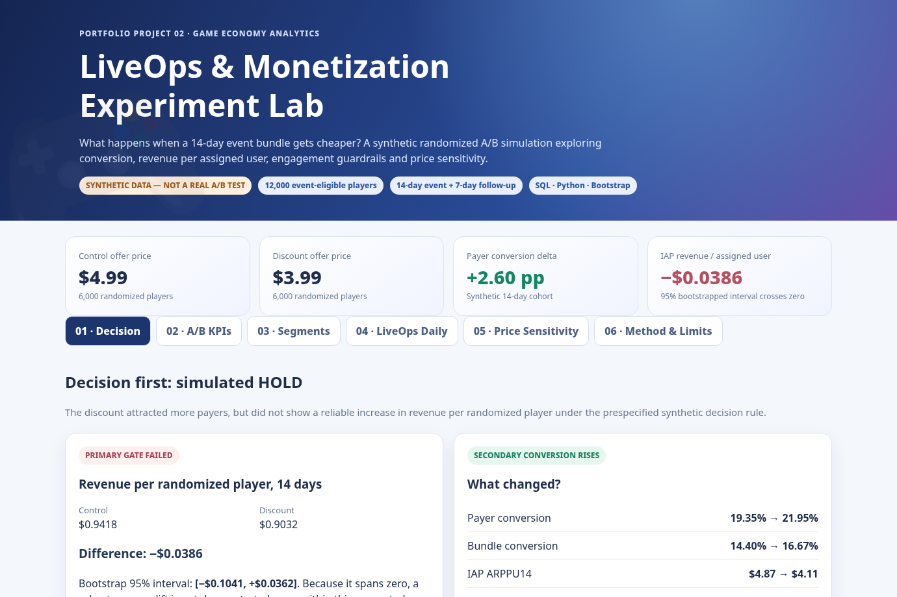
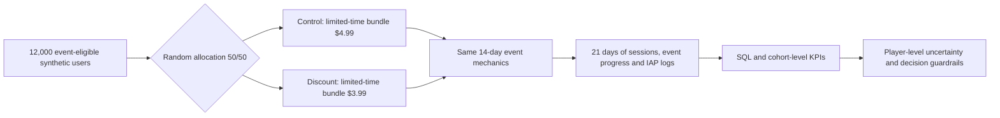

# 🎮 Game Monetization & LiveOps Optimizer

**A reproducible synthetic A/B experiment for a limited-time F2P bundle.**  
**Player Behavior · LiveOps · IAP Analytics · Pricing · Statistical Decisions**



> **Important:** Every player, event, purchase and experiment result is generated from stated assumptions. This is a portfolio simulation, **not** a real live-game A/B test, empirical elasticity estimate, or evidence that a discount will affect real players as modeled.

## The business problem

A limited-time event offers a special bundle. Should the studio lower the price **from $4.99 to $3.99** to increase payer conversion? Or will the discount reduce revenue per randomized user despite bringing in more buyers?

This complements the [Game Economy Simulator & Optimizer](https://github.com/orenzavadi-droid/Game-Economy-Simulator-and-Optimizer-), which focuses on designing *soft-currency sources, sinks and progression*. **This project focuses on decisions made around a live event, segmentation, monetization and experimental evidence.**

## At a glance

| Feature | Implementation |
|---|---|
| Synthetic event-eligible cohort | 12,000 players randomized 50/50 at event launch |
| Window | 14-day LiveOps event + 7-day follow-up |
| A/B treatment | **Only the limited-time bundle price changes**: $4.99 vs $3.99 |
| Segments | Casual (50%), Regular (35%), Enthusiast (15%) — assumed, not learned |
| Data instrumentation | Event, milestone, impression, offer purchase, organic purchase, churn, session logs |
| KPI analysis | Payer conversion, offer conversion, IAP RPU14, ARPDAU, ARPPU, event completion, D7/D14 return |
| Analysis | Python, SQLite, 6 SQL queries, player-level bootstrapped uncertainty |
| Decision | Preregistered primary metric and guardrails; **SIMULATED HOLD** |
| Pricing extension | Six price candidates × three elasticity assumptions; illustrative sensitivity only |
| Integrity | Revenue ledger audit, consistent randomized denominators, automated tests |

## Design: one variable, randomized arms



**Eligibility:** all players are active on day 1 by construction. D7 is **exact day 7 after event launch**, divided by all players originally randomized to that group, not D7 after a real install. No acquisition funnel is modeled.

**Primary KPI:** `IAP RPU14 = all in-app-purchase revenue on event days 1–14 / all randomized users` for each arm. This intention-to-treat denominator prevents selecting only players who purchased or saw the offer. This is **not** ARPDAU, which is tracked separately on a daily-active-user denominator.

## Main simulated result

| KPI (day 1–14 unless noted) | Control ($4.99) | Discount ($3.99) |
|---|---:|---:|
| Payer conversion / randomized | **19.35%** | **21.95%** |
| Bundle conversion / randomized | 14.40% | **16.67%** |
| IAP RPU14 | **$0.9418** | $0.9032 |
| IAP ARPPU14 | **$4.8673** | $4.1148 |
| D7 exact return / randomized | 44.52% | 44.90% |
| Event completion | 29.78% | 30.12% |

The observed synthetic IAP RPU14 difference (Discount minus Control) is **−$0.0386** per randomized user. The player-level bootstrap 95% interval is approximately **[−$0.1041, +$0.0362]**, which includes zero. Therefore this sample is *not* evidence of a reliable increase or decrease even **within the simulated model**.

**Decision under the documented exercise rule: `SIMULATED HOLD`**. The confidence-interval lower bound on RPU improvement fails the pre-specified positive-revenue gate, while simulated engagement guardrails pass. This is not a recommendation for a real product without live data.

## What is NOT claimed

- No real player data, no real purchases, no actual A/B deployment, no real causal uplift.
- Purchase sensitivity is **assumed**, not estimated; the price-response model is invented for instructional purposes.
- The offer price is the only direct variant change; **retention does not directly respond to price in the modeled rules**. Similar D7 is largely by design.
- The 21-day cumulative RPU is a bounded follow-up measure, **not actual or forecast lifetime value (LTV)**.
- No ad revenue, refunds, taxes, subscriptions, currency exchange, paid UA or real revenue recognition.
- A bootstrap interval describes sampling variability in the synthetic user cohort, **not** external validity.

## Navigate the project

| What you want | Where |
|---|---|
| **Interactive dashboard** | [`reports/dashboard.html`](reports/dashboard.html) — offline, no CDN |
| **Learning companion** | [`LEARNING_KIT.html`](LEARNING_KIT.html) — Hebrew, flashcards, code explanations and quiz |
| Executive analysis | [`reports/LiveOps_Analysis_Workbook.xlsx`](reports/LiveOps_Analysis_Workbook.xlsx) |
| Decision memo | [`reports/DECISION_MEMO.md`](reports/DECISION_MEMO.md) |
| Model card | [`docs/MODEL_CARD.md`](docs/MODEL_CARD.md) |
| Experiment pre-registration / guardrails | [`docs/EXPERIMENT_PLAN.md`](docs/EXPERIMENT_PLAN.md) |
| Python engine | [`src/model.py`](src/model.py) |
| Analysis + bootstrap | [`src/analyze.py`](src/analyze.py) |
| Price sensitivity | [`src/pricing.py`](src/pricing.py) |
| Six queries | [`sql/`](sql/) and [`reports/*.csv`](reports/) |
| Test suite | [`tests/`](tests/) |

## Run locally

Python 3.10+:

```bash
python -m venv .venv
# Windows: .venv\Scripts\activate
# macOS/Linux: source .venv/bin/activate
pip install -r requirements.txt
python -m src.run_analysis
python -m pytest -q
```

Open `reports/dashboard.html` and `LEARNING_KIT.html` directly in any modern browser. No local server, Python or internet connection is needed to view them.

This public-ready bundle stores compact CSV outputs, a 1,000-event sample, dashboard, learning guide and spreadsheet. It deliberately excludes the full generated `data/events.csv`, `data/users.csv` and `data/liveops.sqlite` — **regenerate these** with the command above. An Excel workbook is a populated *snapshot* of results, not a controller for Python simulation.

## Pipeline and data integrity

1. `src/model.py` randomly assigns exactly half the eligible cohort to each variant, generates player-day events and IAP transactions using stated persona- and price-response assumptions.
2. `src/run_analysis.py` writes CSVs and builds SQLite tables (`users`, `events`).
3. Six SQL queries compute daily ARPDAU, randomized-user payer funnel, personas, revenue ledger, exact-day return and offer/organic revenue split.
4. `src/analyze.py` computes player-level bootstrap intervals for *preselected* outcomes and applies the written decision rule.
5. `src/pricing.py` replays assumed response curves over candidate prices in low/base/high sensitivity settings. **It is not an econometric price optimization estimate.**
6. The ledger audit requires `revenue_usd_21(user) = sum(revenue_usd from all their purchase events)` for every one of the 12,000 users.

## Definitions and methodology references

- [GameAnalytics metrics](https://docs.gameanalytics.com/events-metrics-and-filtering/metrics/) — definitions of daily active users, retention, ARPDAU/ARPU and ARPPU.
- [Unity A/B testing](https://activation.unity3d.com/glossary/a-b-testing) — control and treatment, random assignment and defined metrics.
- [Unity Game Overrides experiments](https://docs.unity.com/en-us/game-overrides/ab-testing) — separate success metrics and experiment sizing.

This is an original educational project and is not affiliated with a game studio or a live title. Figures and rules are deliberately hypothetical.
